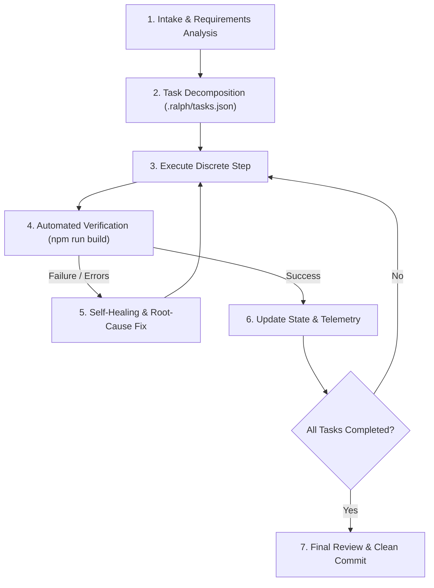

# Ralph Loop Autonomous Iteration Protocol

This repository implements the **Ralph Loop** pattern for continuous autonomous problem solving, iterative development, and automated self-healing.

## Core Loop Lifecycle

## Ralph Loop Rules for Agents
1. **Never Assume — Always Verify**: After modifying any code, execute `npm run build` immediately.
2. **Context Preservation**: Update `.ralph/tasks.json` at each iteration so progress is never lost across context resets.
3. **Strict Design Token Adherence**: Keep all components aligned with Stitch design tokens (`tailwind.config.js`).
4. **Single-Responsibility Iterations**: Make focused, atomic commits rather than massive monolithic changes.

## Verification Commands
- Build & Typecheck: `npm run build`
- Preview Server: `npm run preview -- --port 4173`
- Development Server: `npm run dev`

